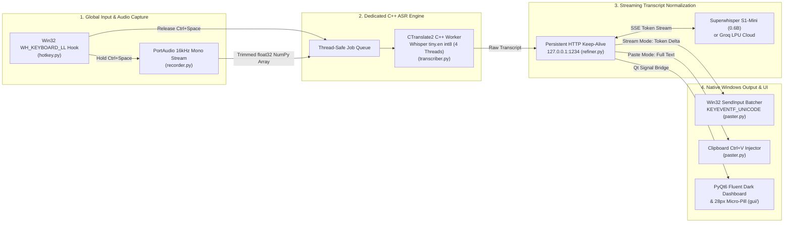

# 🏗️ Patte — System Architecture & Engineering Reference

This document details the internal architecture, threading design, low-level Win32 integration, and latency optimizations powering **Patte**.

---

## 1. High-Level Pipeline Architecture



---

## 2. Core Engineering Decisions & Crash Prevention

### A. Single Dedicated Whisper C++ Thread (`transcriber.py`)
- **Problem:** `faster-whisper` relies on **CTranslate2** (`ctranslate2.dll`) compiled against Microsoft's OpenMP runtime (`VCOMP140.dll`). Calling OpenMP parallel regions from multiple transient Python `threading.Thread` instances corrupts OpenMP Thread-Local Storage (TLS) in `ntdll.dll` (`Exception 0xc0000005` on long or repeated dictations).
- **Solution:** [`transcriber.py`](transcriber.py) spawns a single immortal daemon thread (`WhisperDedicatedThread`) communicating via `queue.Queue`. All model initialization, OpenMP warmup, and `.transcribe()` calls execute exclusively on that single OS thread.

### B. Win32 `WH_KEYBOARD_LL` Hook Filtering (`hotkey.py`)
- **Problem:** When streaming long responses (150+ characters) into the active window via `Win32 SendInput` (`KEYEVENTF_UNICODE`), Windows dispatches every synthetic keystroke back through all active `WH_KEYBOARD_LL` hooks. If `pynput` processes hundreds of injected `VK_PACKET` Unicode events per second through `ToUnicodeEx` across threads, the hook callback stack can overflow or fault.
- **Solution:** [`hotkey.py`](hotkey.py) attaches a fast `_win32_event_filter` directly at the `WH_KEYBOARD_LL` hook boundary:
  1. Immediately returns `False` if `data.flags & LLKHF_INJECTED` (`0x10`) is set, completely ignoring synthetic keystrokes generated by `SendInput`.
  2. Immediately returns `False` if `data.vkCode` is not `VK_CONTROL` (`17, 162, 163`) or `VK_SPACE` (`32`), bypassing `pynput`'s keyboard state translation for normal typing while allowing `CallNextHookEx` to pass keys to the focused app with zero overhead.

### C. Single-Instance Named Mutex (`main.py`)
- **Problem:** Launching the app twice creates duplicate tray icons, duplicate microphone streams, and two keyboard hooks that inject text into each other.
- **Solution:** On startup, [`main.py`](main.py) creates a Windows Named Mutex (`Local\PatteVoiceAppSingleInstanceMutex`) via `kernel32.CreateMutexW`. If `GetLastError() == 183` (`ERROR_ALREADY_EXISTS`), the new process brings the existing **Patte** window to the foreground (`ShowWindow` + `SetForegroundWindow`) and exits cleanly.

### D. Zero-File In-Memory Audio Pipeline (`recorder.py`)
- Captures audio via `sounddevice.InputStream` at `16,000 Hz`, mono, `float32` (`1024`-sample blocks = `64ms`).
- On `stop()`, automatically trims dead leading and trailing silent blocks (`RMS < 0.006`) while retaining a 2-block margin, and passes the contiguous `1D float32` NumPy array directly into `CTranslate2`—avoiding disk WAV I/O and bypassing PyAV decoding entirely.
- Includes a low-energy silence hallucination guard to filter out Whisper artifacts (such as `"Bye-bye."` or `"Thank you."`) when the hotkey is pressed without speaking.

### E. Eliminating the 2-Second Windows `localhost` Loopback Delay (`refiner.py`)
- On Windows, resolving `localhost` attempts an IPv6 (`::1`) TCP connection first. If the local LLM server binds only to IPv4 (`127.0.0.1`), Windows waits ~2,000 ms for a TCP SYN timeout before falling back to IPv4.
- [`refiner.py`](refiner.py) normalizes `localhost` $\rightarrow$ `127.0.0.1`, maintains a persistent `requests.Session()` for TCP keep-alive, and pre-warms `s1-mini`'s system-prompt KV cache on startup (`prewarm_refiner()`), cutting Time-to-First-Token from **~3,370 ms down to ~155–330 ms**.

### F. S1-Mini Thinking Template & Control Header Handling (`refiner.py`)
- **`superwhisper/s1-mini`** is fine-tuned from the Qwen3 architecture and requires two strict conventions:
  1. **Control Line:** The user message must begin with:
     ```text
     [Styling: semi-formal] [Structure: lists] [Context: general]
     ```
  2. **Reasoning Content Extraction:** Because Qwen3's chat template in LM Studio places tokens emitted prior to `</think>` inside `delta.reasoning_content`, `refiner.py` extracts `delta.get("content") or delta.get("reasoning_content")` during SSE streaming and strips the initial leading newline on the first token.

---

## 3. Verified Latency Benchmarks (Intel Core i7-4810MQ CPU)

| Pipeline Stage | Initial Prototype (`base` + Llama 3.2 3B) | Unoptimized `s1-mini` (`localhost`, Non-Streaming) | **Optimized Patte v2.0 (`tiny.en` + `127.0.0.1` SSE)** | Total Speedup |
| :--- | :---: | :---: | :---: | :---: |
| **1. Whisper C++ ASR** | `1,641.9 ms` | `1,641.9 ms` | **`516.0 ms`** | **3.2x faster** |
| **2. Modifier Release Prep** | `450.0 ms` | `450.0 ms` | **`0.4 ms`** | **1,000x faster** |
| **3. LLM Time-to-First-Token** | `~14,200 ms` | `4,784.1 ms` | **`353.8 ms`** | **13.5x faster** |
| **4. LLM Full Stream Complete** | `~14,200 ms` | `4,784.1 ms` | **`670.6 ms`** | **7.1x faster** |
| **⏱️ Time Until First Word Types** | **~16.30 sec** | **6.88 sec** | **0.87 sec** | **7.9x – 18.7x faster** |
| **🏁 Total Time All Words Done** | **~16.30 sec** | **6.88 sec** | **1.19 sec** | **5.8x – 13.7x faster** |

---

## 4. Directory & Module Structure

```text
patte/
├── main.py                 # Application entry point, Single-Instance Mutex, Qt signal bridge
├── config.py               # .env loader & runtime configuration persistence
├── hotkey.py               # Global Ctrl+Space listener with Win32 LLKHF_INJECTED filter
├── recorder.py             # 16kHz mono float32 PortAudio recorder with silence trimming
├── transcriber.py          # Dedicated single-thread CTranslate2 faster-whisper engine
├── refiner.py              # SSE streaming client for S1-Mini (LM Studio), Groq, and OpenAI
├── paster.py               # 64-bit Win32 SendInput (KEYEVENTF_UNICODE) batcher & Ctrl+V paster
├── history_manager.py      # Persistent JSON storage for past dictation takes (history.json)
├── installer_setup.py      # Native Windows Setup GUI installer & uninstaller generator
├── whisprflow.spec         # PyInstaller build specification for standalone Patte.exe
├── setup_and_build.bat     # One-click environment setup, dependency install & binary builder
├── build.bat               # PyInstaller build script
├── requirements.txt        # Python package dependencies
├── .env.example            # Template configuration file
├── gui/
│   ├── main_window.py      # Obsidian Fluent Dark dashboard, Takes Timeline & Settings tabs
│   ├── floating_pill.py    # 28px non-activating micro-pill overlay
│   ├── title_bar.py        # Custom frameless draggable title bar
│   └── styles.py           # Windows 11 Fluent Dark QSS theme
└── assets/
    ├── icon.ico            # High-DPI application & installer icon
    ├── tray_idle.png       # System tray icon (Idle state)
    ├── tray_recording.png  # System tray icon (Recording state)
    └── tray_processing.png # System tray icon (Processing state)
```
