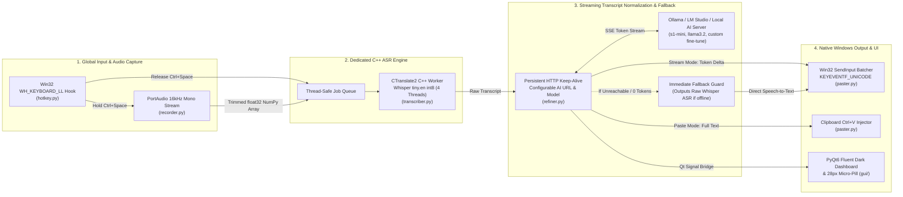

# 🏗️ Patte — System Architecture & Engineering Reference

This document details the internal architecture, threading design, low-level Win32 integration, network AI endpoint support, and latency optimizations powering **Patte**.

---

## 1. High-Level Pipeline Architecture



---

## 2. Core Engineering Decisions & Reliability Features

### A. Single Dedicated Whisper C++ Thread (`transcriber.py`)
- **Problem:** `faster-whisper` relies on **CTranslate2** (`ctranslate2.dll`) compiled against Microsoft's OpenMP runtime (`VCOMP140.dll`). Calling OpenMP parallel regions from multiple transient Python `threading.Thread` instances corrupts OpenMP Thread-Local Storage (TLS) in `ntdll.dll` (`Exception 0xc0000005` on repeated dictations).
- **Solution:** [`transcriber.py`](transcriber.py) spawns a single immortal daemon thread (`WhisperDedicatedThread`) communicating via `queue.Queue`. All model initialization, OpenMP warmup, and `.transcribe()` calls execute exclusively on that single OS thread.

### B. Win32 `WH_KEYBOARD_LL` Hook Filtering (`hotkey.py`)
- **Problem:** When streaming long responses into the active window via `Win32 SendInput` (`KEYEVENTF_UNICODE`), Windows dispatches every synthetic keystroke back through all active `WH_KEYBOARD_LL` hooks. If `pynput` processes hundreds of injected `VK_PACKET` Unicode events per second through `ToUnicodeEx` across threads, the hook callback stack can overflow.
- **Solution:** [`hotkey.py`](hotkey.py) attaches a fast `_win32_event_filter` directly at the `WH_KEYBOARD_LL` hook boundary:
  1. Immediately returns `False` if `data.flags & LLKHF_INJECTED` (`0x10`) is set, completely ignoring synthetic keystrokes generated by `SendInput`.
  2. Immediately returns `False` if `data.vkCode` is not `VK_CONTROL` (`17, 162, 163`) or `VK_SPACE` (`32`), bypassing `pynput`'s keyboard state translation for normal typing while allowing `CallNextHookEx` to pass keys to the focused app with zero overhead.

### C. Zero-File In-Memory Audio Pipeline (`recorder.py`)
- Captures audio via `sounddevice.InputStream` at `16,000 Hz`, mono, `float32` (`1024`-sample blocks = `64ms`).
- Automatically trims dead leading and trailing silent blocks (`RMS < 0.006`) while retaining a 2-block margin, and passes the contiguous `1D float32` NumPy array directly into `CTranslate2`—avoiding disk WAV I/O.
- Includes a low-energy silence guard to filter out Whisper artifacts when the hotkey is tapped without speaking.

### D. Model-Aware Prompting & Offline Fallback (`refiner.py`)
- **Model-Aware Adaptation:**
  - When `AI_MODEL` is `s1-mini`, Patte automatically formats inputs with Superwhisper's specialized control line (`[Styling: semi-formal] [Structure: lists] [Context: general]`) with `temperature: 0.2`.
  - When using general LLMs (`llama3.2`, `qwen`, `mistral`, or custom fine-tunes), it formats requests using standard system instructions with `temperature: 0.0`.
- **Offline / Unreachable Safety:** If the AI server URL is unreachable, times out (after 3.0s connect timeout), or returns 0 tokens, Patte **never hangs or crashes**. It instantly falls back to raw Whisper speech-to-text and types/pastes the transcription directly.

### E. Zero-Python Standalone Distribution
- Packaged using PyInstaller with full Qt6 runtime libraries, CTranslate2 OpenMP binaries, and PortAudio drivers included.
- Installs to `%LOCALAPPDATA%\Programs\Patte` and runs out-of-the-box on clean Windows 10/11 machines without requiring Python, Git, or system environment setup.

---

## 3. Directory & Module Structure

```text
patte/
├── main.py                 # Application entry point, Qt application lifecycle, signal bridges
├── config.py               # .env loader, AI endpoint URL & model settings persistence
├── hotkey.py               # Global Ctrl+Space listener with Win32 LLKHF_INJECTED filter
├── recorder.py             # 16kHz mono float32 PortAudio recorder with silence trimming
├── transcriber.py          # Dedicated CTranslate2 C++ Whisper worker thread
├── refiner.py              # Model-aware AI refinement client with SSE streaming & offline fallback
├── paster.py               # Win32 SendInput Unicode streamer & clipboard Ctrl+V fallback
├── history_manager.py      # Takes timeline storage (JSON persistence)
├── installer_setup.py      # Self-contained Windows installer generator
├── dev_reload.bat          # 1-click developer rebuild, deploy, and diagnostic launch script
├── whisprflow.spec         # PyInstaller build specification with complete dynamic dependency collection
├── gui/
│   ├── main_window.py      # Fluent dark dashboard, settings view with live Test Connection button
│   ├── floating_pill.py    # Non-activating micro-pill overlay
│   ├── title_bar.py        # Windows 11 custom title bar controls
│   └── styles.py           # Obsidian QSS stylesheet
└── assets/                 # Icons and system tray graphics
```
